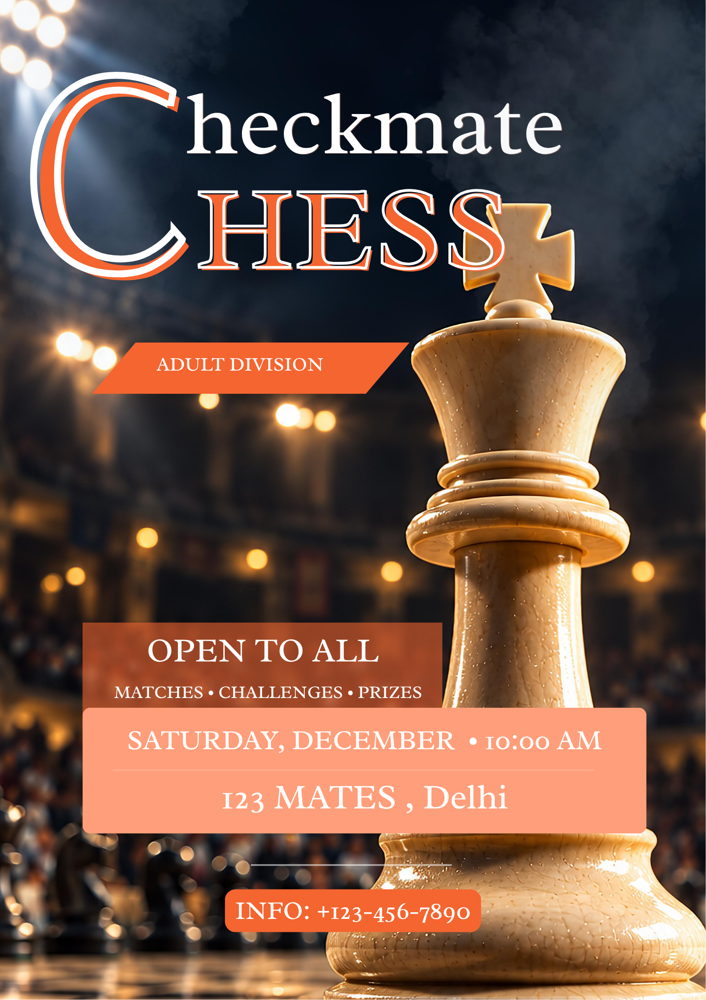

# Graphic Design Posters

A graphic design portfolio featuring two projects: **Checkmate Chess**, an event poster for an open-to-all adult-division chess tournament, and **SkyWithAI**, a social media promo post for an AI-powered flight booking brand.

Both designs focus on bold typography, a strong visual hierarchy and clear calls to action.

---

## Projects

### 1. Checkmate Chess – Tournament Poster



**Type:** Event poster (portrait, print and digital)

**Brief:** Promote an open-to-all chess tournament for the adult division and make the date, venue and contact details easy to find at a glance.

**Design highlights**
- Dramatic, low-light chess-piece background to set a competitive, high-stakes mood
- Large two-tone title lettering in orange and white for instant recognition
- Orange "Adult Division" tag and "Matches • Challenges • Prizes" tagline to communicate the event quickly
- Dedicated date, time and venue block, with a separate contact button at the bottom
- Dark navy and warm orange palette for strong contrast and readability

> The venue and phone number shown are sample placeholder details.

---

### 2. SkyWithAI – Flight Promotion Post


**Type:** Social media post (4:5 portrait)

**Brief:** Promote an AI-powered flight planning and booking brand with a discount offer, in a format built for social feeds.

**Design highlights**
- Full-bleed aircraft and sky photograph that supports the "travel far" message
- Large, clean white headline, "Fly smart, travel far", with a short supporting line
- "Up to 30% off" offer set large on the right to draw the eye
- "Book now @SkyWithAI" call to action placed at the bottom
- Brand logo in the top-left corner for recognition

---

## Design Focus

| Skill | Where it shows |
|---|---|
| Typography | Contrasting display lettering and clean sans-serif text across both designs |
| Visual hierarchy | Title first, then offer or tag, then details and call to action |
| Colour and contrast | Orange on navy for Checkmate Chess; white text on sky imagery for SkyWithAI |
| Layout | Clear information blocks and generous spacing for quick reading |
| Call to action | Contact block on the poster and "Book now" on the social post |

---

## Repository Structure

```
graphic-design-posters/
├── assets/
│   ├── Checkmate_chess.png
│   └── SkyWithAI.png
└── README.md
```

---

## About the Designer

**Manan Jain**, B.Tech Computer Science and Engineering student at Maharaja Agrasen Institute of Technology, Delhi, with an interest in graphic design and visual communication.

- LinkedIn: [linkedin.com/in/manan-jain-362b4a35a](https://linkedin.com/in/manan-jain-362b4a35a/)
- GitHub: [github.com/mananjain815](https://github.com/mananjain815)
- Email: jainmanan815@gmail.com

---

## Usage

These designs are shared as portfolio work. 
